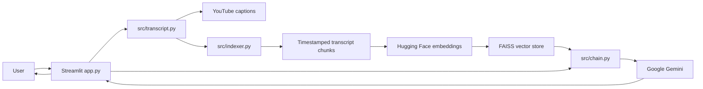

# TubeMind AI

TubeMind is a transcript-grounded YouTube chatbot. Paste a public YouTube URL or video ID, index its English or Telugu captions, and ask questions with answers linked to relevant moments in the video.

## Problem

Long videos are difficult to search efficiently. TubeMind turns captions into a searchable FAISS index and uses retrieval-augmented generation (RAG) to answer questions from the video rather than unsupported general knowledge.

## Features

- Accepts watch, short, embed, Shorts, and live YouTube URLs, along with raw video IDs.
- Fetches English or Telugu transcript segments with original timestamps.
- Splits transcripts into overlapping chunks and indexes them with Hugging Face sentence embeddings and FAISS.
- Retrieves relevant passages for each question and generates transcript-grounded answers with Gemini.
- Shows source excerpts with clickable links that seek to the cited point in the video.
- Keeps follow-up context, reports indexing statistics, and caches embeddings and per-video indexes.
- Handles missing captions, unavailable videos, invalid links, missing credentials, and model/API errors.

## Technology

Python · Streamlit · LangChain · YouTube Transcript API · Hugging Face `all-MiniLM-L6-v2` · FAISS · Google Gemini

## Architecture



## RAG workflow

1. The app validates the supplied YouTube URL or ID and fetches English or Telugu caption segments.
2. Captions are split into overlapping chunks. Each chunk retains source timing metadata.
3. Hugging Face embeds the chunks and FAISS builds a similarity-search index. The index is cached by video ID.
4. For each question, the retriever selects relevant chunks. Gemini receives those excerpts and conversation history, with instructions to answer only from the excerpts.
5. The UI displays the answer and expandable source excerpts linked to their timestamps in the video.

## Setup (Windows PowerShell)

Python 3.10 or newer is recommended. From the project directory:

```powershell
py -m venv .venv
Set-ExecutionPolicy -Scope Process -ExecutionPolicy RemoteSigned
.\.venv\Scripts\Activate.ps1
python -m pip install --upgrade pip
pip install -r requirements.txt
if (!(Test-Path .env)) { Copy-Item .env.example .env }
```

Edit `.env` and replace `your_google_ai_api_key_here` with a Google AI API key. The `.env` file is ignored by Git. The sentence-transformer model downloads the first time embeddings are created, so the first indexing run may take longer and requires internet access.

## Run

```powershell
streamlit run app.py
```

Open the local URL printed by Streamlit, paste a public YouTube link, and select **Process video**. For Streamlit Community Cloud, deploy this repository with `app.py` as the entry point and add `GOOGLE_API_KEY` to the app's Secrets settings.

Run the tests with:

```powershell
python -m unittest discover -s tests -v
```

## Screenshots

Screenshots are not included yet. Suggested captures: the empty workspace, an indexed video with its preview, and a response with timestamped source excerpts.

## Limitations

- Videos must be public and have captions accessible through YouTube Transcript API. Availability and request limits are controlled by YouTube.
- Answers depend on transcript quality and retrieval results; they are not a substitute for watching the source.
- Gemini requires a valid API key and is subject to Google AI quota and regional availability.
- The first Hugging Face model download increases indexing time. In-memory caches are local to the running instance and clear on restart.
- Conversations and indexes are not persisted across deployments.

## Future improvements

- Add persistent vector storage and conversation history.
- Add transcript-language selection, video title metadata, and source relevance controls.
- Add deployment monitoring, request limits, and an evaluation set for answer quality.